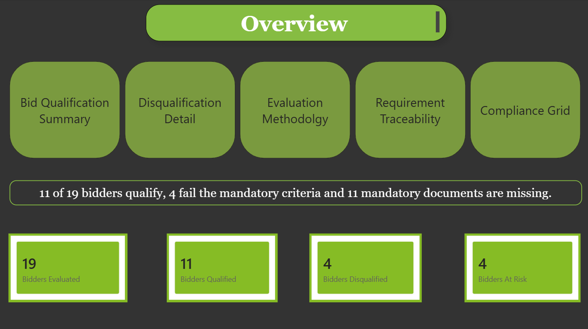
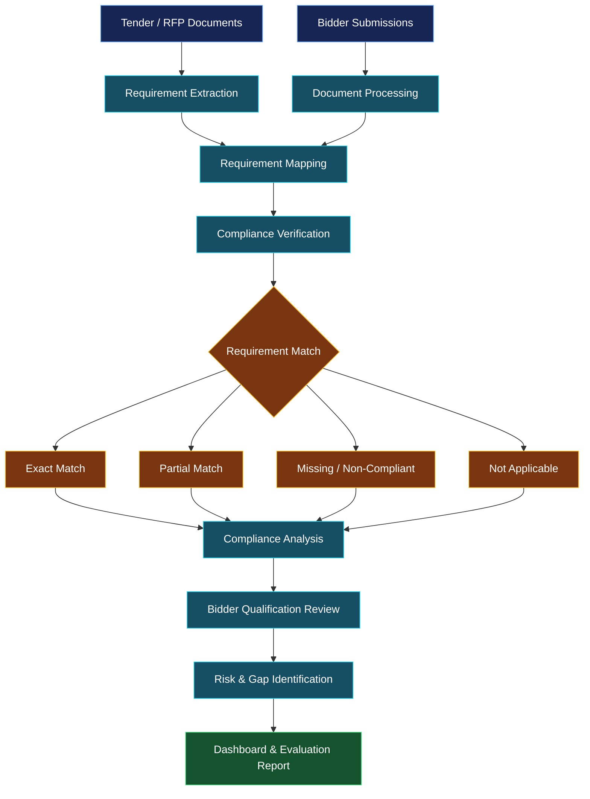

# TenderIQ - A Bid Compliance & Evaluation System

**An intelligent platform for bid qualification, tender compliance verification, requirement traceability, and evaluation reporting.**

[](https://saral2810.github.io/Bid-Compliance-System/)
[](https://github.com/Saral2810/Bid-Compliance-System)

---

## 🌐 Interactive 3D Workflow

Explore the conceptual bid evaluation pipeline through an interactive 3D visualization.

### [▶ Launch Interactive 3D Demo](https://saral2810.github.io/Bid-Compliance-System/3d_bid_compliance_system.html)


---

## 📌 Project Overview

TenderIQ is a bid compliance and evaluation system designed to organize bidder submissions, evaluate requirement-level compliance, identify documentation gaps, and present qualification results through analytical dashboards.

### ✨ Key Features

- 📄 **Bid Evaluation:** Organizes tender requirements and bidder submissions.
- ✅ **Compliance Verification:** Presents exact, partial, non-matching, and non-applicable requirement matches.
- 🏆 **Bidder Qualification:** Summarizes qualified, at-risk, and disqualified bidders.
- 🔍 **Requirement Traceability:** Tracks compliance findings across bidders and individual requirements.
- ⚠️ **Gap Identification:** Highlights missing documents and potential compliance issues.
- 📊 **Evaluation Dashboards:** Visualizes compliance results, qualification summaries, and evaluation metrics.
- 🧊 **Interactive 3D Visualization:** Demonstrates the conceptual workflow through an interactive HTML experience.

---

## 📸 Dashboard Showcase

### 1. Overview

The main dashboard presents an overview of the bid evaluation results.



### 2. Bid Qualification Summary

Visualizes bidder qualification status, compliance percentages, and requirement-level findings.


### 3. Compliance Grid

Displays bidder-level compliance against tender requirements, helping identify missing or incomplete submissions.


### 4. Evaluation Methodology

Presents evaluation test results, requirement-match accuracy, and validation summaries.


### 5. Requirement Tracebility

Checks for Requirements of each bidder against the given tender and marks the percentage of completition.


---

## 🔄 System Workflow

The following diagram illustrates the conceptual flow of bid compliance evaluation, from document submission to evaluation reporting.



---

## 📈 Dashboard Insights

The dashboards provide several views of the evaluation process:

| Dashboard | Purpose |
|---|---|
| Overview | Summarizes the evaluation results |
| Bid Qualification Summary | Presents bidder qualification categories |
| Compliance Grid | Compares bidders against individual requirements |
| Evaluation Methodology | Displays validation results and match metrics |
| Requirement Traceability | Examines requirement matches across bidders |

---

## 📂 Repository Structure

```text
Bid-Compliance-System/
├── README.md
├── LICENSE
├── 3D-visualization.HTML
├── Screenshots/
│   ├── Overview.png
│   ├── Compliance Grid.png
│   ├── Evaluation Methodology.png
│   └── Bid Qualification Summary.png
└── BidCompliance_Master-Copy.xlsx
```

---

## 🎯 Project Objective

To make bid evaluation easier to understand and review by consolidating bidder information, requirement-level compliance findings, documentation gaps, and qualification results into a structured analytical interface.

The project demonstrates how dashboards and interactive workflow visualization can support a more transparent and organized evaluation process.

---

## 👨‍💻 Author

**Saral Singhal**

---

<p align="center">
  <b>TenderIQ</b><br>
  Making bid compliance easier to understand, evaluate, and track.
</p>
